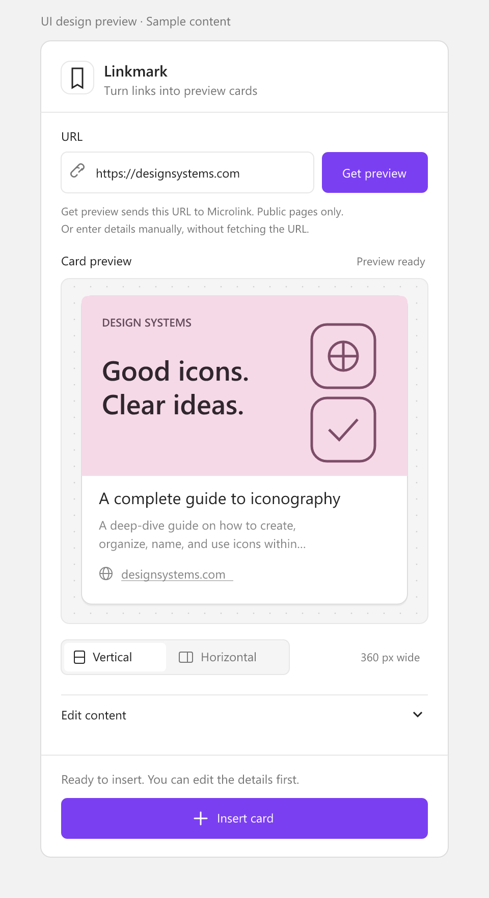

# Linkmark

Turn public links into editable bookmark cards in Figma Design.

Paste a URL, preview its cover, title and description, then insert a clean card with a link to the original page. The default card takes its visual cues from FigJam bookmarks: an image above the content, a white surface, a fine border, soft corners and a source link.



## Install locally

1. Download this repository and keep the extracted folder in a stable location.
2. Open a Design file in the **Figma desktop app**.
3. Choose **Plugins → Development → Import plugin from manifest…**.
4. Select `manifest.json` from this folder.
5. Run **Plugins → Development → Linkmark**.

No build step, npm installation or API key is required to run the plugin. `code.js` and `ui.html` are ready to load. You can also open `ui.html` in a browser to inspect the panel and fetch a preview; inserting requires the Figma plugin environment.

## Features

- Retrieve the page title, description, cover and website icon.
- Choose a 360 px vertical card or a 480 px horizontal card.
- Edit the text, replace the image URL or upload a JPG, PNG or WebP cover.
- Insert editable layers with Auto Layout. Title and source links point to the original URL.
- Use manual entry when a page cannot be fetched, or insert without a cover.
- Create additional cards beside the previous result without replacing existing canvas content.
- Prefill from a selected URL text layer or a previous Linkmark card, without automatically sending a request.

The interface, notifications, documentation and listing materials are in English. Website content retains its original language.

## Preview service and privacy

**Get preview** sends the entered URL to the public [Microlink API](https://microlink.io/docs/api/getting-started/overview). Covers and icons load from the returned image hosts. The free service currently advertises [25 requests per day](https://microlink.io/pricing), checked on 2026-10-30. Linkmark caches up to 20 results in memory during a session. Daily limits, network restrictions and site metadata affect availability.

Use public URLs only. Login-protected content is not fetched. Manual entry remains available if a request fails. Uploaded covers are processed locally, resized to a maximum 1600 px edge and stored in the Figma document; they are not sent to Microlink. See [Privacy](PRIVACY.md).

This is a static card generator. It does not embed live websites, play videos, intercept global paste or update existing cards automatically. Figma's native [createLinkPreviewAsync](https://developers.figma.com/docs/plugins/api/properties/figma-createlinkpreviewasync/) is available only in FigJam.

## Development

Node.js 20 or later is required only to run the checks:

```sh
npm ci
npm run check
```

The checks cover input validation, source URL preservation, layout structure, manual entry, safe text rendering, stale responses, error handling, image payloads and English UI copy. Type checking uses the official Figma Plugin API definitions. An optional GitHub Actions template is provided in docs/check-workflow.yml. To enable CI, place it at .github/workflows/check.yml using credentials with workflow permission.

Edit `code.js` or `ui.html`, then restart the development plugin to load your changes.

## Validation status

- 15 automated logic checks and a Plugin API static type check are included.
- Live public metadata requests returned titles and descriptions for example.com and the official Figma plugin-samples repository; the latter also returned cover and icon URLs with a CORS-compatible API response.
- The UI design illustration has been rendered and inspected.
- Figma desktop runtime validation is still required: actual layout, image import, fonts, theme behavior and link opening have not been confirmed in the editor.

The illustration above is not evidence of an editor run. The original design reference is [Figma's bookmark example](https://help.figma.com/hc/article_attachments/15326932963735).

## Publish to Figma Community

See [Publishing](PUBLISHING.md) for the personal-account workflow, ready-to-paste English listing copy, artwork and runtime checklist. `linkmark-local` is a local development identifier, not a published Community ID. Use the ID that Figma assigns to the plugin under your personal account before publishing or updating it.

Publishing this GitHub repository does not submit the plugin to Figma Community. Linkmark is independent and is not affiliated with Figma or Microlink.
